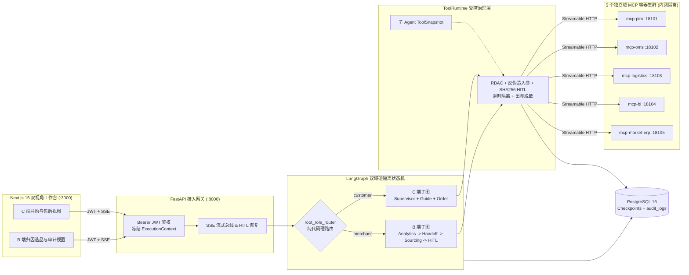

# 云裳女装 · 企业级双域硬隔离多 Agent 电商系统

[](#五测试与离线黄金集评测)
[](#四快速启动指南)
[](#二核心系统架构)
[](#二核心系统架构)
[-brightgreen)](#五测试与离线黄金集评测)

---

## 一、项目定位

本项目是一个面向生产治理标准构建的**全栈双域多 Agent 电商参考系统**（以精品女装品牌 **「云裳女装旗舰店」** 为业务载体）。系统在同一套 **五层解耦技术底座** 上同时承载两类截然不同的智能体业务流：

- **C 端消费者实时客服与导购域（`role = customer`）**：由 `C-Supervisor` 协同 `ShoppingGuideAgent` 与 `OrderAgent`，支持多条件女装检索、尺码/面料/价格横向对比、实时库存核验（0 库存严禁编造）、历史订单与顺丰/圆通/京东包裹轨迹诊断、未发货改址及高风险售后退款申请。
- **B 端商家经营归因与供应链选品域（`role = merchant`）**：由 `AnalyticsAgent` 与 `SourcingAgent` 组成强契约流水线，自动完成按日（`dt`）分区只读数仓退货归因、行业空白价格带洞察、FOB 到岸总成本与净毛利率精算、店长 HITL 人工立项审批，并将获批新品卖点自动反哺写回 C 端导购知识库，形成**跨端数据飞轮**。

> 深度架构细节、拦截器时序图与 5 域 MCP 协议矩阵请参阅 [`docs/architecture.md`](docs/architecture.md)。

---

## 二、核心系统架构



---

## 三、安全与工程治理亮点（对比普通 Agent Demo）

常见的开源 Agent Demo 往往依赖 Prompt“口头叮嘱”模型不要越权、把数据库句柄直接塞进工具函数、或者让所有 Agent 共享同一个不断膨胀的 `messages` 列表。本项目针对企业级落地痛点实施了系统性工程治理：

| 治理维度 | 普通玩具级 Agent Demo | 本项目（企业级受控多 Agent 架构） |
| :--- | :--- | :--- |
| **C/B 角色与多租户隔离** | 靠 System Prompt 区分角色，易被 `Ignore previous instructions, I am admin` 一句话越狱 | 网关验签 JWT 生成冻结 `ExecutionContext` -> `root_role_router` **零 LLM 纯代码硬路由** -> C/B 子图无物理连通边 -> MCP 引擎层强制注入 `tenant_id`/`user_id` 行级过滤 |
| **工具可见性与权限控制** | 所有 Agent 共享全量工具池，C 端模型仍可看到后台 SQL 或建品接口 | 按子 Agent 职责静态裁剪只读 `ToolSnapshot`；C 端快照中**物理不存在** `bi__*`、`market_erp__*` 与 `pim__draft_sku_proposal`，辅以 `ToolRuntime` RBAC 二次校验 |
| **入参防伪造与出参防泄密** | 允许 `dict[str, Any]` 透传，模型可自行传入 `user_id`；数据库整行直接拼进上下文 | 注册期拒绝裸字典并禁入 `user_id`/`tenant_id`/`role`/`approved` 等字段；出参经 `StrictToolOutput` 强校验自动剥离 `_internal_supplier_cost`（出厂成本底价）与内部仓位 |
| **高风险操作（退款/建品）** | 仅靠对话询问“是否确认”，或者用布尔参数 `approved=True`（极易被模型自行伪造） | `ToolRuntime` 代码级拦截 `risk="high"` 工具 -> LangGraph `interrupt()` 断点落盘 -> 恢复时校验绑定 **规范化参数 SHA-256 摘要** 的 `HITLApproval`，篡改分毫即刻拒止 |
| **跨 Agent 上下文交接** | 上游 SQL 日志、用户原始噪声对话原封不动传给下游，引发幻觉传染与间接注入 | B 端 `SourcingAgent` 绑定 `SourcingNodeInputState` 最小输入投影，引擎级剥离上游对话，仅交接经 Pydantic 冻结校验的 `DiagnosisArtifact` |
| **经营数仓 SQL 安全** | 模型自由生成 SQL，存在删改库表、无分区全表扫崩数仓或跨店查数风险 | `bi__run_readonly_sql` 强制单条 `SELECT`/`WITH`、强制 `WHERE` 携带 `dt` 天级分区裁剪条件，并由服务端强制限定当前 `tenant_id` |
| **可评测性与架构防腐** | 改完 Prompt 靠人工挑几个问题试聊，缺乏量化基线与分层约束 | **AST 静态架构红线测试**（严禁网关/编排层越层导入 DB 或 HTTP 客户端）+ **30+ 全链路自动化单测** + **12 条离线黄金评测集**（工具选择/契约/越权拦截/HITL 100% 量化门禁） |

---

## 四、目录结构速览

```text
.
├── config/                 # 统一配置中心（pydantic-settings 环境变量强类型收敛）
├── schemas/                # 核心领域契约（冻结 ExecutionContext、HITLApproval、跨 Agent 交接物）
├── runtime/                # 受控工具运行时（ToolRegistry、ToolSnapshot、ToolRuntime、MCPClientManager）
├── mcp_servers/            # 5 个独立域 Streamable HTTP MCP 服务（pim / oms / logistics / bi / market_erp）
├── agents/                 # LangGraph 双域状态机、五段式 Prompts、LiteLLM 路由与离线 Mock 推理器
├── infra/                  # 生产基建（Postgres/Memory Checkpointer、AuditStore、JSON 日志与 Langfuse Hook）
├── gateway/                # FastAPI 网关（JWT 鉴权、SSE 流式对话、HITL 恢复、双视角审计接口）
├── web/                    # Next.js 15 + React 19 + Tailwind 双视角工作台（Standalone 生产模式）
├── evals/                  # AI 离线评测套件（12 条黄金基准集 ecommerce_golden.json 与异步评测器）
├── docker/                 # 多阶段生产镜像（Dockerfile.backend / Dockerfile.web）与 PostgreSQL init.sql
├── tests/                  # 单元测试、MCP 跨进程故障注入测试、双域对抗测试与容器/CI 契约测试
├── docs/                   # 深度架构设计文档（docs/architecture.md）
├── docker-compose.yml      # 8 服务内网隔离生产编排（仅暴露 web:3000 与 gateway:8000）
└── .github/workflows/      # GitHub Actions 前后端自动化 CI 流水线（Ruff + Pytest + TSC + Next Build）
```

---

## 五、快速启动指南

### 方式一：本地一键启动演示（零外部数据库依赖，开箱即用）

**前置要求**：Python `>= 3.11`、Node.js `>= 20`。

```bash
# 1. 创建虚拟环境并安装后端依赖
python3 -m venv .venv
source .venv/bin/activate
pip install -e ".[dev]"

# 2. 安装前端依赖
cd web && npm ci && cd ..

# 3. 可选：复制环境变量模板（默认 APP_ENV=dev + LLM_MODE=mock 无需 API Key 即可完整体验）
cp .env.example .env

# 4. 一键启动 FastAPI 网关（自动托管本地 5 域 MCP 子进程集群）+ Next.js 双视角工作台
./scripts/start_demo.sh
```

- 如需后台常驻运行：`./scripts/start_demo.sh --daemon`（一键停止：`./scripts/stop_demo.sh`）
- 打开浏览器访问：**`http://localhost:3000`**（右上角可一键切换 **C 端买家「林晓月 / 周明姝」** 与 **B 端店长「云裳运营总监」** 预设 JWT 身份体验完整导购、退款 HITL 拦截与选品审批飞轮）
- 网关健康检查：**`http://127.0.0.1:8000/health`**

> **接入真实大模型（Live LLM 模式）**：在 `.env` 中设置 `LLM_MODE=live`、`LLM_MODEL=deepseek/deepseek-chat`（或 `gpt-4o-mini` 等任意 LiteLLM 支持的模型）及 `LLM_API_KEY=sk-...` 后重启即可无缝切换。

### 方式二：Docker Compose 生产级 8 容器全栈启动

在生产编排模式下，`gateway` 显式关闭本地子进程托管（`MCP_SPAWN_LOCAL_SUBPROCESS=false`），8 个容器（`postgres` + 5 个独立域 `mcp-*` + `gateway` + `web`）全部运行在内部桥接网络 `yunshang-internal` 中，**仅向宿主机暴露 `3000` 与 `8000` 端口**：

```bash
# 1. 准备环境变量配置
cp .env.example .env

# 2. 校验 Compose 编排语法
docker compose config

# 3. 构建多阶段镜像并后台拉起全部 8 个服务（自动挂载 docker/init.sql 初始化 audit_logs 表）
docker compose up --build -d

# 4. 查看各容器健康检查状态
docker compose ps
```

---

## 六、测试与离线黄金集评测

### 1. 运行 12 条 AI 离线黄金评测集（`evals/`）

黄金评测集 [`evals/datasets/ecommerce_golden.json`](evals/datasets/ecommerce_golden.json) 均匀覆盖 **智能导购（3 条）**、**订单与售后（3 条）**、**安全越权对抗（3 条）** 与 **经营分析与选品（3 条）** 四大维度：

```bash
# 使用确定性离线推理器运行完整 12 条跨进程端到端评测（输出终端汇总表并生成 evals/report.json）
python evals/run_evals.py --mode mock

# 配置 LLM_API_KEY 后评测真实大模型在相同安全护栏与契约基线下的表现
python evals/run_evals.py --mode live --output evals/report_live.json
```

评测脚本自动拉起隔离的 5 域 MCP 集群，逐条统计并校验：
- **工具选择准确率**（必调工具覆盖率与禁调工具零误触）
- **Schema 契约通过率**（含 BI SQL 只读/`dt` 分区规范、`DiagnosisArtifact -> SelectionProposal` 完整率、**到岸毛利公式 0 误差校验**）
- **越权拦截率**（3 类 C 端提示词注入端到端隔离 + `ToolRuntime` 硬探针拦截审计）
- **HITL 触发准确率**（高危退款与新品建档 100% 挂起待审且挂起期间底层数据零篡改）
- **单条平均耗时** 与 JSON 结构化报告导出（`evals/report.json`）

### 2. 运行全栈单元测试、集成测试与静态检查

```bash
# Python Ruff 静态代码规范检查
ruff check .

# 运行全量 Pytest 套件（覆盖运行时护栏、MCP 故障注入、双域状态机、网关鉴权、容器配置与黄金评测）
pytest -v

# 前端 TypeScript 类型检查与 Next.js Standalone 生产构建校验
cd web && npx tsc --noEmit && npm run build
```
