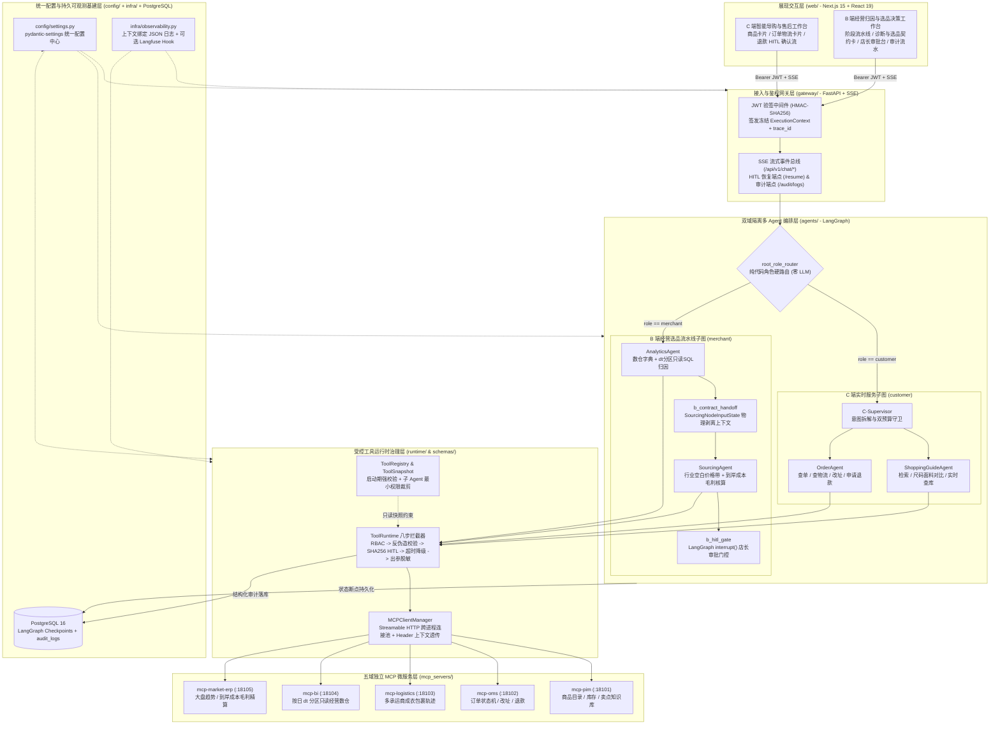
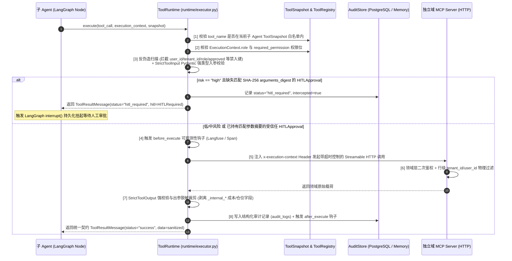
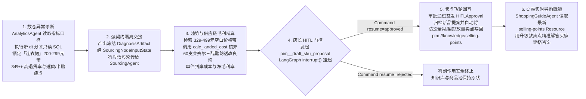

# 系统架构设计文档（Architecture & Governance Specification）

本文档系统化阐述**云裳女装双域多 Agent 电商系统**的五层解耦架构、C/B 双域硬隔离机制、`ToolRuntime` 前后置安全拦截链路、5 域 MCP 协议规范以及跨端闭环数据飞轮。

---

## 1. 五层解耦架构全景（Five-Layer Decoupled Architecture）

系统在代码目录、进程边界与静态依赖层面严格划分为五层，并通过 AST 静态红线单测（`tests/test_gateway_api.py`、`tests/test_multi_agent_flows.py`、`tests/test_config_settings.py`）杜绝任何跨层违规直连：

### 各层职责与静态架构红线

| 层级 | 核心模块 | 职责边界 | 强制静态红线（单测守护） |
| :--- | :--- | :--- | :--- |
| **L1 接入网关层** | `gateway/auth.py` `gateway/main.py` | 校验 Bearer JWT、注入不可变 `ExecutionContext`、暴露 SSE 流式对话与 HITL 审批恢复接口 | 严禁导入 `sqlite3`、`sqlalchemy` 或 `mcp_servers.*`；严禁散落 `os.environ` |
| **L2 编排层** | `agents/graph.py` `agents/prompts.py` `agents/llm.py` | 双域状态机拓扑、五段式 Prompt 资产、LiteLLM 重试/降级路由（离线 Mock 独立拆分于 `agents/mock_llm.py`） | 严禁导入 `httpx`、`requests`、`aiohttp`、`sqlite3`、`sqlalchemy` 或 `mcp_servers.*` |
| **L3 运行时层** | `runtime/registry.py` `runtime/executor.py` `runtime/mcp_adapter.py` | 工具元数据强校验注册、子 Agent 快照裁剪、前后置 RBAC/Schema/HITL 拦截、MCP 跨进程通信适配 | 严禁向模型暴露任何身份字段；严禁信任 `ToolCall.arguments` 中的审批标记 |
| **L4 领域服务层** | `mcp_servers/*_server.py` `mcp_servers/protocol.py` | 5 个可独立容器化部署的 Streamable HTTP MCP 服务，提供领域逻辑、行级多租户隔离与 `/health` 探针 | 领域服务必须执行二次身份与权限复核，不假设上游调用方绝对可信 |
| **L5 基建与配置层** | `config/settings.py` `infra/*` | 环境变量强类型收敛、PostgreSQL Checkpointer 与 `audit_logs` 存储、结构化 JSON 日志、本地子进程集群托管 | 生产模式强制 `MCP_SPAWN_LOCAL_SUBPROCESS=false`，网关与 MCP 完全进程解耦 |

---

## 2. C/B 双域硬隔离与纵深防御机制（Dual-Domain Hard Isolation）

在电商场景中，C 端买家与 B 端运营人员共用同一套技术底座，但数据敏感度截然不同（B 端包含全店 GMV、品类退货率、工厂 FOB 出厂成本价、预估净毛利率与选品建档写权限）。系统通过**四道代码级纵深防线**确保即使发生恶性提示词注入（Prompt Injection），C 端会话也 **0% 可能**触达 B 端工具或数据：

1. **第一道防线：服务端可信身份锚点（`ExecutionContext`）**
   - `ExecutionContext`（`schemas/context.py`）声明为 `ConfigDict(frozen=True, extra="forbid")`，仅由网关层 `JWTAuthMiddleware` 验签服务端密钥后构造并绑定 `trace_id`、`tenant_id`、`user_id`、`role` 与 `permissions`。
   - 客户端请求体或对话文本中伪造的 `role=merchant`、`tenant_id`、`user_id`、`approved=true` 均不会进入 `ExecutionContext`。
2. **第二道防线：Root Router 零 LLM 纯代码硬分流**
   - 顶层状态图入口 `START` 绑定纯 Python 函数 `root_role_router(state)`，100% 依据 `ExecutionContext.role` 分流至 `c_domain_subgraph` 或 `b_domain_subgraph`。
   - 两个子图在编译后的 LangGraph 拓扑中**不存在任何跨子图连通边**，且各自使用物理隔离的状态键前缀（`c_*` 与 `b_*`）。
3. **第三道防线：子 Agent 最小权限 `ToolSnapshot` 与 Resource 白名单**
   - `build_agent_snapshots(registry)` 在启动期为 4 个业务子 Agent 分别裁剪不可变的只读 `ToolSnapshot`，并执行防御性断言：
     - `ShoppingGuideAgent` 仅可见：`pim__hybrid_search`、`pim__compare_skus`、`pim__check_stock` 及 `pim://knowledge/selling-points`；
     - `OrderAgent` 仅可见：`oms__search_orders`、`oms__update_address`、`oms__create_refund`、`logistics__track_pkg` 及订单/物流规范文档；
     - B 端工具（`bi__*`、`market_erp__*`、`pim__draft_sku_proposal`）甚至不会出现在 C 端子 Agent 的 LLM Tool Schema 上下文中。
4. **第四道防线：B 端跨 Agent 投影状态隔离（`SourcingNodeInputState`）**
   - 在 B 端流水线中，`AnalyticsAgent` 需要读取数仓明细，可能接触到用户退货留言等非受控文本。
   - `sourcing_agent` 节点在 LangGraph 注册时显式绑定 `input_schema=SourcingNodeInputState`（仅含 `execution_context` 与 `diagnosis_artifact` 两个键），由图引擎在节点入口**物理剥离**上游 `user_input`、SQL 原始记录与对话上下文，`SourcingAgent` 仅消费经 Pydantic 冻结校验的 `DiagnosisArtifact` 结构化交接物。

### C 端与 B 端防失控预算守卫

- **C 端双计数器熔断**：`c_handoff_count <= 4`（防止 `OrderAgent <-> ShoppingGuideAgent` 乒乓死循环）且 `c_total_steps <= 12`（防止单轮工具重试风暴），超限立即优雅降级收敛。
- **B 端单节点步数上限**：每个专业 Agent 节点独立受 `b_agent_max_steps = 8` 约束，避免异常 SQL 重试失控。

---

## 3. `ToolRuntime` 前后置拦截治理链路（ToolRuntime Interceptor Pipeline）

所有子 Agent 发出的 `ToolCall` 严禁直接请求外部接口，100% 必须流经 `ToolRuntime.execute()` / `ToolRuntime.execute_batch()` 的八步受控管道：

### 核心安全设计细节

1. **注册期红线门禁（`ToolRegistry.register`）**：
   - 工具名称必须符合 `<domain>__<action>` 规范（如 `oms__create_refund`）；
   - 入参 Schema 必须继承 `StrictToolInput`（`extra="forbid"`），**严禁声明裸 `dict[str, Any]`**，且严禁在 Schema 中定义 `user_id`、`tenant_id`、`role`、`permissions`、`approved`、`bypass_hitl` 等身份控制字段。
2. **防篡改 HITL 审批凭证（SHA-256 参数摘要绑定）**：
   - 当 `oms__create_refund` 或 `pim__draft_sku_proposal`（`risk="high"`）首次调用时，`ToolRuntime` 对规范化 JSON 参数计算 SHA-256 `arguments_digest`，返回 `status="hitl_required"` 并由编排图执行 `interrupt()` 挂起。
   - 人工在前端点击“批准”后，网关通过 `ExecutionContext.with_hitl_approval(...)` 签发绑定 `tool_call_id`、`tool_name` 与 `arguments_digest` 的 `HITLApproval`；若恢复时工具名称或任何参数字段（如退款金额、立项单价）被篡改，摘要比对立即失败并拒绝放行。
3. **并发批处理乱序完成与保序对齐（`execute_batch`）**：
   - 支持单轮多 `ToolCall` 通过 `asyncio.Semaphore` 受控并发请求多个 MCP 服务，无论底层网络快慢乱序返回，最终严格按输入 `tool_calls` 顺序一一对齐返回 `list[ToolResultMessage]`，任何单点超时或业务异常均收敛为结构化 `ErrorPayload`，绝不抛出未捕获异常击穿外层编排图。

---

## 4. 五域 MCP 协议规范与能力矩阵（5-Domain MCP Protocol Specification）

5 个业务域均基于 Streamable HTTP MCP 协议实现，每个服务支持独立容器启动（`python -m mcp_servers.<domain>_server --host 0.0.0.0 --port <port>`）并暴露标准 `GET /health` 探针。

### 4.1 跨进程安全上下文透传协议

- `MCPClientManager` 在每次请求时将服务端受信任 `ExecutionContext` 的最小授权载荷编码至 HTTP Header `x-execution-context`。
- 每个 MCP Server 入口统一调用 `authorize_domain_call(ctx, permission=..., allowed_roles=...)` 完成领域侧二次鉴权，并从上下文直接提取 `tenant_id` 与 `user_id` 用于底层数据过滤。

### 4.2 五域 12 工具与权限/风险矩阵

| 业务域 (默认端口) | 标准工具全名 | 允许角色 | 所需权限位 (`permission`) | 风险等级 | 核心领域护栏与脱敏策略 |
| :--- | :--- | :--- | :--- | :---: | :--- |
| **PIM 商品库存域** (`18101`) | `pim__hybrid_search` | `customer`, `merchant` | `pim:catalog:read` | `low` | 按 `tenant_id` 过滤商品池；出参自动剥离 `_internal_supplier_cost` 与 `_internal_warehouse_bin` |
| | `pim__compare_skus` | `customer`, `merchant` | `pim:catalog:read` | `low` | 2~5 款女装尺码/颜色/面料/价格横向对比，严格校验租户归属 |
| | `pim__check_stock` | `customer`, `merchant` | `pim:stock:read` | `low` | 实时库存核验；0 库存返回 `INSUFFICIENT_STOCK` 业务错误防止导购虚报有货 |
| | `pim__draft_sku_proposal` | `merchant` | `pim:sku:propose` | **`high` (HITL)** | 仅限 B 端且必须经店长 HITL 审批；建档成功后将新品卖点追加写回卖点知识库 |
| **OMS 订单售后域** (`18102`) | `oms__search_orders` | `customer`, `merchant` | `oms:orders:read` | `low` | 禁止无过滤条件全表扫描；C 端强制 `buyer_user_id == ctx.user_id`，剥离 `_internal_channel_fee` |
| | `oms__update_address` | `customer`, `merchant` | `oms:orders:update_address` | `medium` | 状态机门禁：仅 `pending` / `paid` 未出库订单可改址，已发货返回 `ORDER_STATUS_DISALLOWS_ADDRESS_UPDATE` |
| | `oms__create_refund` | `customer`, `merchant` | `oms:refund:create` | **`high` (HITL)** | 强制人工审批门控；校验 `refund_amount <= total_amount` 且拦截 `refunded` 重复退款 |
| **Logistics 物流域** (`18103`) | `logistics__track_pkg` | `customer`, `merchant` | `logistics:package:read` | `low` | 校验运单租户与买家归属；剥离承运商结算底价 `_internal_carrier_settlement_cost` |
| **BI 经营数仓域** (`18104`) | `bi__get_table_schema` | `merchant` | `bi:schema:read` | `low` | 仅限 B 端；返回数仓表字段定义与天级分区列 `dt` 说明 |
| | `bi__run_readonly_sql` | `merchant` | `bi:sql:query` | `low` | **三重 SQL 门禁**：① 仅允许单条 `SELECT`/`WITH`；② `WHERE` 必须显式含 `dt` 分区裁剪；③ 引擎层强制注入 `tenant_id` 过滤防止跨店串数 |
| | `bi__render_chart` | `merchant` | `bi:chart:render` | `low` | 生成结构化经营可视化图表配置载荷 |
| **Market & ERP 域** (`18105`) | `market_erp__search_trends` | `merchant` | `market_erp:trends:read` | `low` | 仅限 B 端；检索女装大盘增长率、空白价格带与消费者退货痛点 |
| | `market_erp__calc_landed_cost` | `merchant` | `market_erp:cost:calculate` | `low` | 校验运输方式最低起订量（MOQ）；精算 FOB + 头程运费 + 关税清关 + 整烫包材 + 5% 平台扣点与净毛利率（`<15%` 自动告警） |

### 4.3 五域受控知识与规则 Resource 清单

| Resource URI | 所属域 | 允许读取的子 Agent | 用途说明 |
| :--- | :--- | :--- | :--- |
| `pim://knowledge/selling-points` | `pim` | `ShoppingGuideAgent`, `SourcingAgent` | 女装核心面料卖点、成套穿搭指南与广告法禁用词红线（**支持飞轮动态演进**） |
| `oms://docs/order-state-machine` | `oms` | `OrderAgent` | 订单状态流转矩阵、未发货改址边界与逆向退款规则 |
| `logistics://docs/carrier-sla` | `logistics` | `OrderAgent` | 顺丰/圆通/京东服饰仓揽收与派送时效 SLA 规范 |
| `bi://dictionary/metrics` | `bi` | `AnalyticsAgent` | 经营数仓官方指标口径（`gmv`/`return_rate`/`gross_margin_rate`）与 `dt` 分区规范 |
| `market_erp://policies/return-exchange` | `market_erp` | `SourcingAgent` | 七天无理由试穿退换标准与供应链选品 15% 净毛利率/MOQ 准入红线 |

---

## 5. 跨端闭环数据飞轮（B-to-C Closed-Loop Knowledge Flywheel）

本系统并非孤立的问答机器人，而是打通了**“B 端售后数据归因 -> 供应链选品精算 -> 店长 HITL 审批建档 -> C 端导购知识库实时增强”**的完整业务飞轮：

1. **归因有据**：`AnalyticsAgent` 先读取 `bi://dictionary/metrics` 明确精品女装 `18%` 退货警戒基线，再通过带 `dt` 分区的只读聚合 SQL 发现 `连衣裙` 在 `200-299` 元价格带退货率高达 `34%+`，首要原因为“浅色雪纺单层内衬偏透易走光”与“腰臀尺码偏小梨形身材拉链紧绷”。
2. **精算可控**：`SourcingAgent` 依据 `DiagnosisArtifact` 检索行业趋势，瞄准 `329-499` 元轻奢通勤空白价格带，设计双层防透莱赛尔三醋酸改良款，并通过 `market_erp__calc_landed_cost` 严格校验 MOQ 与扣除全链路成本后的净毛利率，生成强类型 `SelectionProposal`。
3. **审批留痕与飞轮生效**：仅当人工审批人在工作台审核通过高危建品请求后，PIM 域才正式创建草稿并将新提炼的差异化卖点写入 `pim://knowledge/selling-points`，实现 B 端经营决策对 C 端导购话术的实时闭环反哺。
